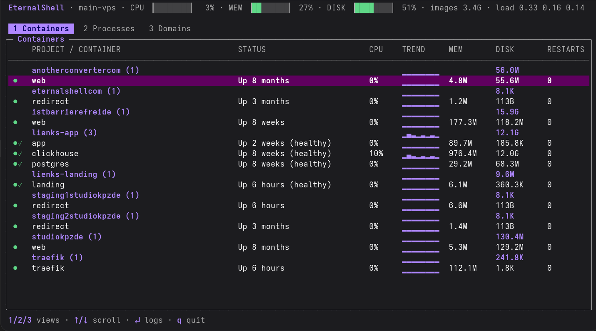
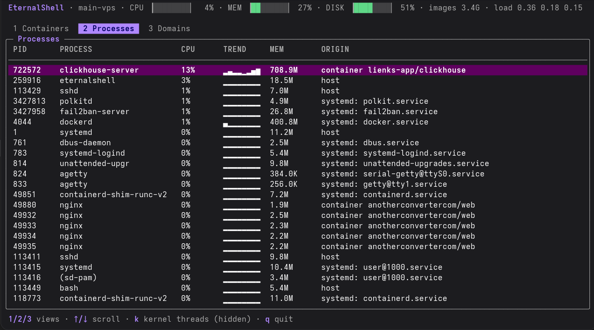
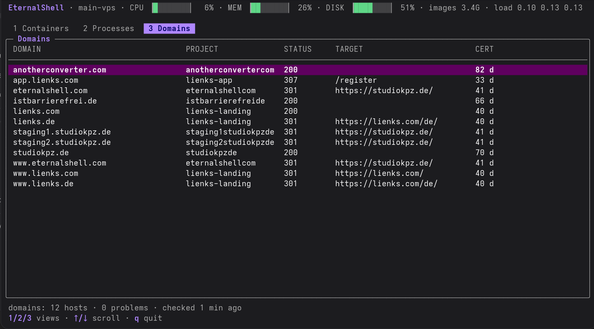
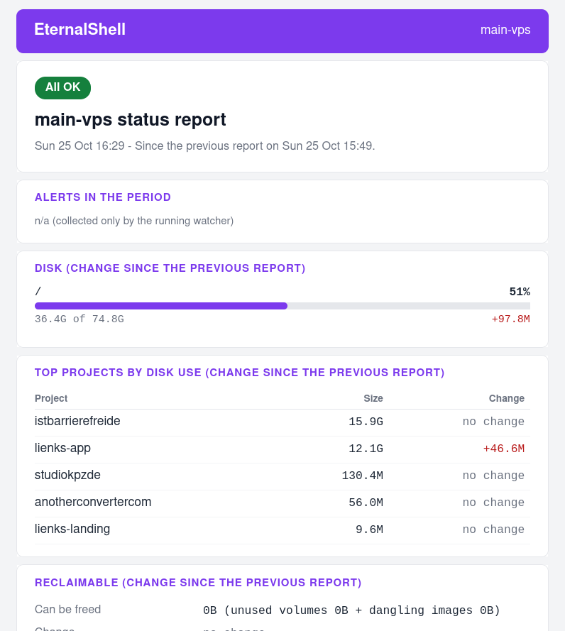

# EternalShell

A small terminal tool that shows what is running on your Linux server, which app each process belongs to, and mails you when something needs attention.



Built for people who run a few servers with Docker Compose projects, Traefik and some systemd services, and who don't want a full monitoring stack.

- **Single binary**, no agent, no database, no web UI.
- **Read-only**: it changes nothing on the server (except a small state file for the report) and opens no ports.
- Made for Ubuntu servers (amd64).

It is not a btop replacement, an uptime monitor or a log tool. It answers "what is running here, does it belong to anything, and is something wrong?"

## Requirements

- Ubuntu server, amd64
- Docker (optional, for the container views and disk use per project)
- Traefik (optional, only for the Domains view)
- An SMTP account for alert and report mails

## Features

### Live terminal UI

Run `eternalshell` to open the terminal UI.

| Key | View |
|-----|------|
| `1` | **Containers**, grouped by Compose project, with CPU, memory and disk use per project. `Enter` shows the logs. |
| `2` | **Processes**, each with its origin: container (and Compose project), systemd service, or host. |
| `3` | **Domains**, taken from your Traefik labels, with HTTP status, redirect target and certificate validity. |

Other keys: `↑`/`↓`, `PgUp`/`PgDn`, `Home`/`End` scroll, `k` show or hide kernel threads (Processes), `q` quit. In the logs, `r` reloads and `Esc` goes back.

**Processes**, with the origin of each process:



**Domains**, checked live:



### Alerts by email

`eternalshell watch` runs as a systemd service and sends a mail when:

- one process uses more than 80 % of a core for 15 minutes, or the whole server is above 90 % for 10 minutes;
- a disk is more than 90 % full. The mail lists the projects that use the most space.

When the problem is gone, you get an all-clear mail. All thresholds can be changed.

### Status report

A daily or weekly report mail, sent at a time you choose, covers:

- what needs attention;
- the alerts of the period;
- disk use and how it changed;
- the top projects by size;
- containers per project;
- CPU average and peak.



## Install

Requires Go 1.26 or newer to build.

```sh
git clone https://github.com/eternalshell-com/eternalshell
cd eternalshell
CGO_ENABLED=0 GOOS=linux GOARCH=amd64 go build -o eternalshell ./cmd/eternalshell
```

Copy the binary, `config.example.yaml` and the `deploy/` folder to your server, then run the installer there:

```sh
scp -r eternalshell config.example.yaml deploy yourserver:~/es-install/
ssh yourserver
cd ~/es-install && sudo ./deploy/install.sh
```

The installer:

1. creates the system user `eternalshell`;
2. installs the binary to `/usr/local/bin`;
3. installs and enables the systemd service. The service starts once the config and the SMTP password are filled in.

It never overwrites an existing config.

Then set up the config and the SMTP password:

```sh
sudoedit /etc/eternalshell/config.yaml      # server name, SMTP, thresholds, report
sudoedit /etc/eternalshell/secret.env       # ETERNALSHELL_SMTP_PASSWORD=...
sudo systemctl restart eternalshell
```

A minimal config:

```yaml
server:
  name: my-server

alerts:
  report:
    enabled: true        # the report is off without this block
    schedule: daily      # daily | weekly
    time: "08:00"        # server local time

smtp:
  host: smtp.example.com
  port: 587              # 465 = implicit TLS, any other port = STARTTLS
  username: me@example.com
  # ... sender and recipient, see config.example.yaml
```

See `config.example.yaml` for all options, including the alert thresholds.

Check that it works:

```sh
sudo systemctl status eternalshell
sudo journalctl -u eternalshell -f
```

To update, build again, copy the files over and run the installer again.

## Commands

```sh
eternalshell                 # live terminal UI (run with sudo for full disk numbers)
eternalshell status          # one-shot summary
eternalshell watch           # alert watcher (normally run by systemd)
eternalshell test-mail       # send a test mail
eternalshell report          # print the status report
eternalshell report --send   # send the status report now
```

`watch`, `test-mail` and `report` read `/etc/eternalshell/config.yaml` by default; use `--config <path>` for another file.

## Security

- **Read-only.** EternalShell reads `/proc`, the Docker API and file sizes. It never starts, stops or changes anything. The only file it writes is the report state in `/var/lib/eternalshell`.
- **No open ports.** The only outgoing connections are:
  - your SMTP server;
  - one HTTPS request per domain from your Traefik labels, while the Domains view is open and once per report.
- **Hardened service.** It runs as its own user, with a hardened systemd unit (`ProtectSystem=strict`, `ProtectHome=read-only`, `NoNewPrivileges`, memory limit).
- **Broad read access.** To measure folder sizes, the service has `CAP_DAC_READ_SEARCH`: it can read any file on the system, but never write.
- **Docker access.** The service user is in the `docker` group, which is effectively root on the host. EternalShell uses that access only to read.
- **Password stays out of the config.** The SMTP password is read from an environment variable.

## License

AGPL-3.0, see [LICENSE](LICENSE).
